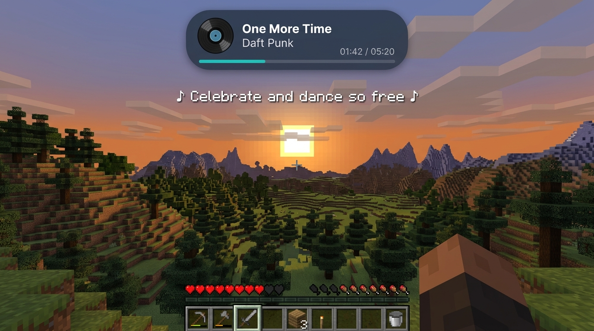

<p align="center">
  
</p>

<h1 align="center">SoundCraft</h1>

<p align="center">
  <b>Universal in-game media player, live synchronized lyrics, and Dynamic Island HUD for Minecraft.</b><br>
  Control your music seamlessly without Alt-Tabbing — works with Spotify, YouTube, browsers, Apple Music, and VLC.
</p>

<p align="center">
  
  
  
  
  
</p>

<p align="center">
  
</p>

---

## Features

* **Universal Media Detection (Cross-Platform):**
  * **Windows:** Connects via Windows GSMTC (Global System Media Transport Controls).
  * **Linux:** Connects via D-Bus MPRIS (`playerctl`).
  * Works with **any** player: Spotify, Chrome, Firefox, Edge, Brave, Apple Music, and VLC.
  * **No Spotify developer account, tokens, or credentials needed!**

* **Dynamic Island HUD:**
  * Clean, floating widget at the top of your screen.
  * Displays album artwork/icon, song title, artist, and a progress bar in real time.
  * Automatically hides when no music is playing.

* **Live Synchronized Lyrics (LRCLIB):**
  * Automatically fetches synchronized lyrics via [LRCLIB](https://lrclib.net/).
  * Displays timed lyrics floating in the sky and inside the player screen.
  * Completely free, legal, and open-source.

* **In-Game Player Screen (Press `J`):**
  * Clean and responsive in-game control panel.
  * Full media controls: Play / Pause, Previous, Next, and seekable progress bar.
  * Live synced lyrics preview and quick toggles for HUD, Sky Lyrics, and Sound Ducking.
  * Customizable keybind under **Options → Controls → Key Binds**.

* **Smart Sound Ducking:**
  * Minecraft background music is smoothly paused whenever external music is playing, and resumes when paused.

* **100% Client-Side:**
  * Server installation is not required. You can join any singleplayer world or multiplayer server (e.g., Hypixel).

---

## Installation

1. Install **Fabric Loader** (version `0.17.x` or newer) for **Minecraft 26.3**.
2. Download the matching **Fabric API** and place it in your `.minecraft/mods` folder.
3. Download the latest `soundcraft-1.0.0.jar` from [Releases](https://github.com/exitishere42/soundcraft/releases).
4. Place `soundcraft-1.0.0.jar` into your `.minecraft/mods` folder.
5. Launch Minecraft, start playing your favorite music on your PC, and press **`J`** in-game!

---

## Default Controls

| Key | Action |
| :--- | :--- |
| **`J`** | Open / Close the SoundCraft Player Screen |
| **`ESC`** | Close Player Screen |

*(All keybinds are rebindable in the standard Minecraft Controls menu).*

---

## Building from Source

Prerequisites:
* **JDK 25** (e.g. Eclipse Adoptium Temurin 25)

```bash
# Clone the repository
git clone https://github.com/exitishere42/soundcraft.git
cd soundcraft

# Build the mod JAR
./gradlew build
```

The compiled mod JAR will be located in `build/libs/soundcraft-1.0.0.jar`.

---

## License

This project is licensed under the **MIT License**. See [LICENSE](LICENSE) for details.
